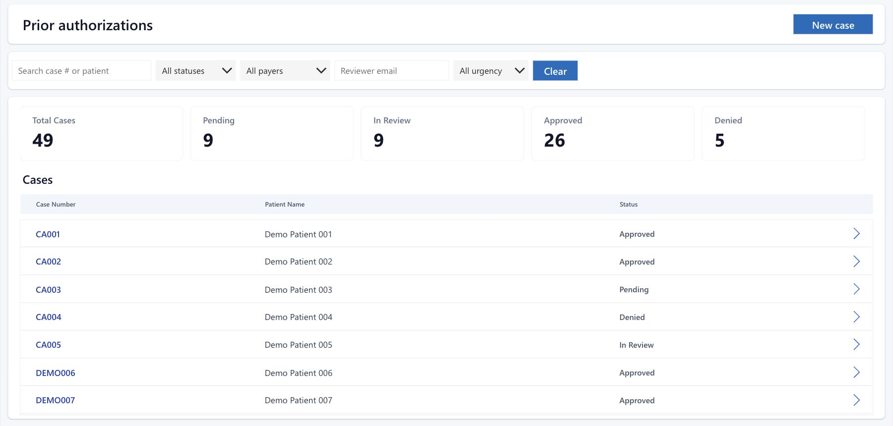
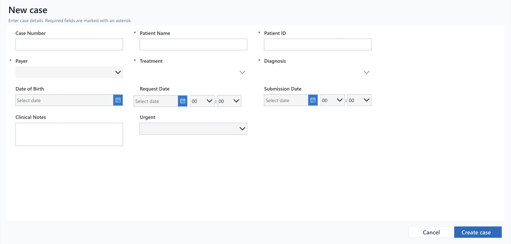
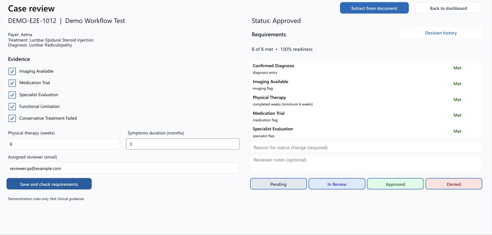
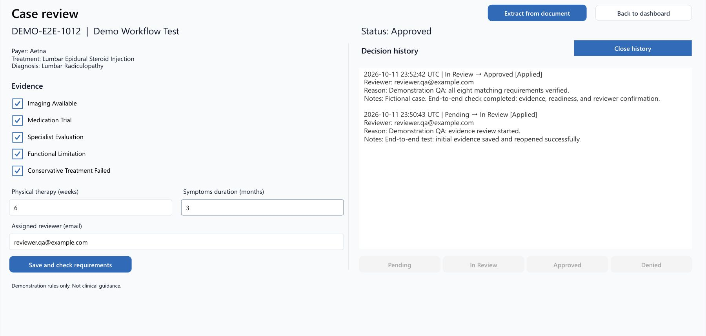
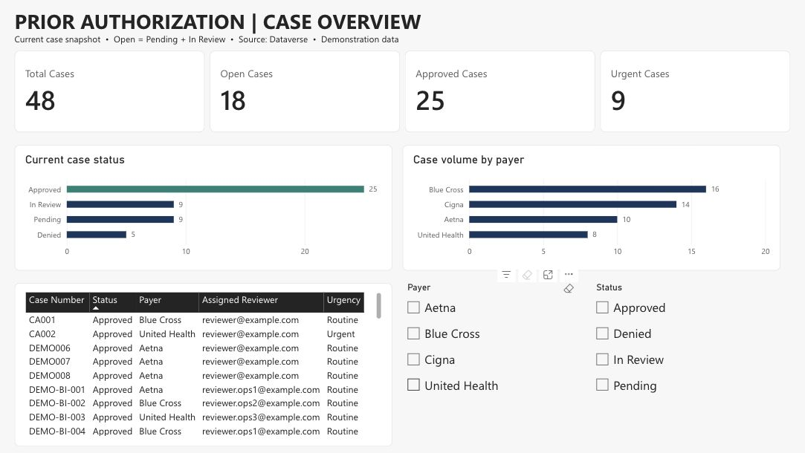
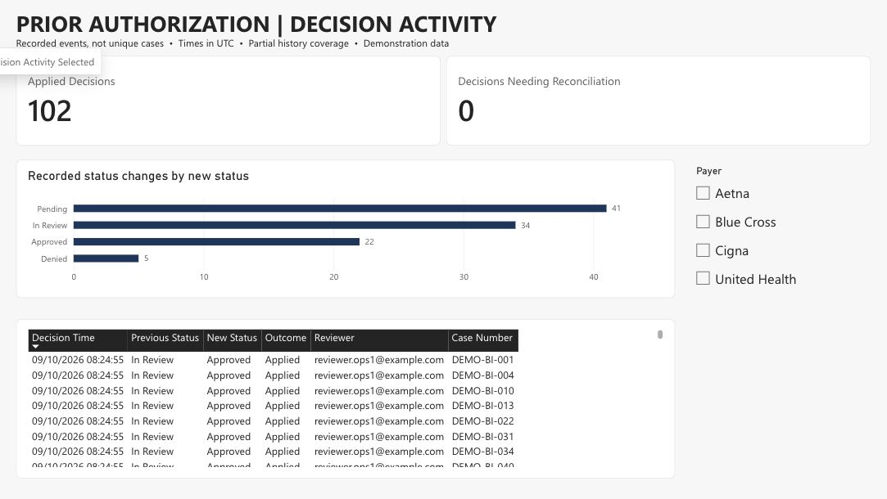
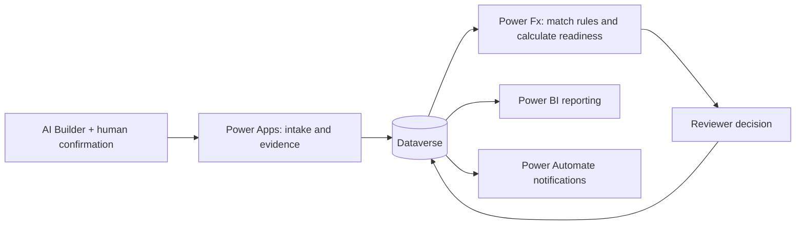

# Prior Authorization Decision Support

A Power Platform application that brings case intake, evidence checks and reviewer decisions into one workflow. Built for prior-authorization coordinators and utilization-management reviewers.

## What it does

- **Manage cases:** create cases, save them in Dataverse, and search/filter by status, payer, reviewer and urgency.
- **Check requirements:** match payer, treatment and diagnosis against active rules. Dependent dropdowns prevent inconsistent selections.
- **Calculate readiness:** use Power Fx to mark each requirement Met or Missing. Readiness is the percentage met; changing evidence clears the previous analysis.
- **Record decisions:** require a reviewer and reason for status changes, with notes, UTC timestamps and decision history.
- **Assist evidence entry:** AI Builder extracts seven values and supporting excerpts from pasted text. Reviewers must check and confirm them before saving.
- **Report activity:** Power BI shows case volumes, status distribution, urgency and recorded decision events.
- **Notify reviewers:** Power Automate contains the Dataverse trigger, case checks and Outlook email action for transitions into In Review. [Configuration and deployment](docs/power-automate.md).

## App walkthrough

Case intake — controlled payer, treatment and diagnosis selections

Case review — evidence, matching requirements and readiness

For the lumbar example, five evidence flags plus four PT weeks and two symptom months produce **6/8 Met → 75% readiness**. Six PT weeks and three symptom months produce **8/8 → 100%**. Approval requires a completed, nonempty analysis with every matched requirement Met and a reviewer-entered reason.

Decision history — reviewer, reason, notes and timestamps

## Power BI dashboards

### Case Overview

Case totals, open and approved requests, urgency, and status/payer distributions. Slicers narrow the metrics and case list.

### Decision Activity

Recorded status changes, applied decisions and records needing reconciliation, with reviewer details and UTC timestamps.

The reports use Import mode. Refresh the semantic model to include newer app records; refreshing visuals alone does not reload Dataverse.

## How it is built

**Dataverse** stores Cases, Requirements and Decisions. **Power Fx** matches active rules by payer/treatment/diagnosis and evaluates exact Requirement Name values through `Switch`. Case and history writes are separate; decision outcomes track Pending, Applied or Failed saves for reconciliation.

**AI Builder** currently supports the lumbar demonstration scenario and pasted text. It assists evidence entry; the reviewer controls the decision. **Power Query and DAX** provide the reporting model and measures.

## Run the demo

1. Provision the Dataverse schema and import the demonstration requirements.
2. Reconstruct the app in Studio from `src/canvas`, then bind your Dataverse connections and AI Builder prompt.
3. Create a fictional case, reopen it, check incomplete/complete evidence, record a decision and verify the dashboard/history update.
4. Configure `DataverseHost` for reporting and destination connections for notifications.

See [setup](docs/setup.md), [demo steps](docs/demo.md) and [export notes](docs/export-status.md). This repository contains source and configuration references; it is not a one-click solution import. Native exports remain local because they contain environment bindings.

## Validation

[End-to-end checks](docs/test-results/2026-10-12/end-to-end-results.md) covered persistence, controlled selections, 75%/88%/100% readiness, evidence-edit invalidation, AI confirmation, decision history and dashboard updates. The canvas app was published after testing. Notification configuration passed Flow checker; delivery testing is part of deployment.

## Where this can be used

The workflow could be adapted for:

- **Provider authorization teams:** organize requests and identify missing evidence before submission.
- **Utilization-management teams:** review requirements and record decisions with reasons and timestamps.
- **Operations managers:** monitor case volumes, status distribution and decision activity through Power BI.

Real-world adoption would require validated payer policies, authenticated access, privacy controls and clinical governance.

## Future scope

- **Access and reliability:** authenticated reviewer roles, atomic decision writes and concurrency handling.
- **Evidence ingestion:** PDF/OCR support, broader AI extraction scenarios and retained source references.
- **Policy management:** versioned rules with effective dates and a controlled update process.
- **Automation:** notification deduplication, reminders and delivery-failure monitoring.
- **Analytics:** scheduled refresh and reliable lifecycle timestamps for SLA and turnaround reporting.
- **Deployment:** managed solutions, automated releases, accessibility improvements and testing at scale.

These enhancements are not implemented. Current demonstration histories do not support reliable SLA or turnaround analysis.

## Data disclaimer

Patient records, evidence, thresholds and rules are invented for demonstration. Payer labels do not represent actual payer policies. This project is not production clinical guidance and must not determine real patient authorization outcomes.
